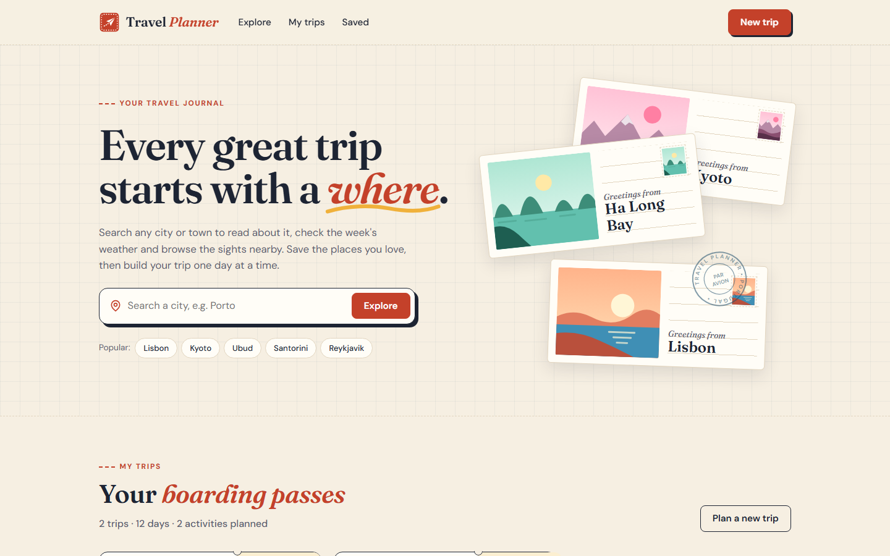
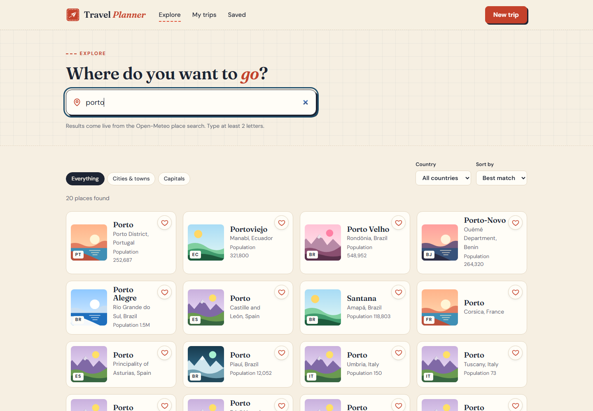
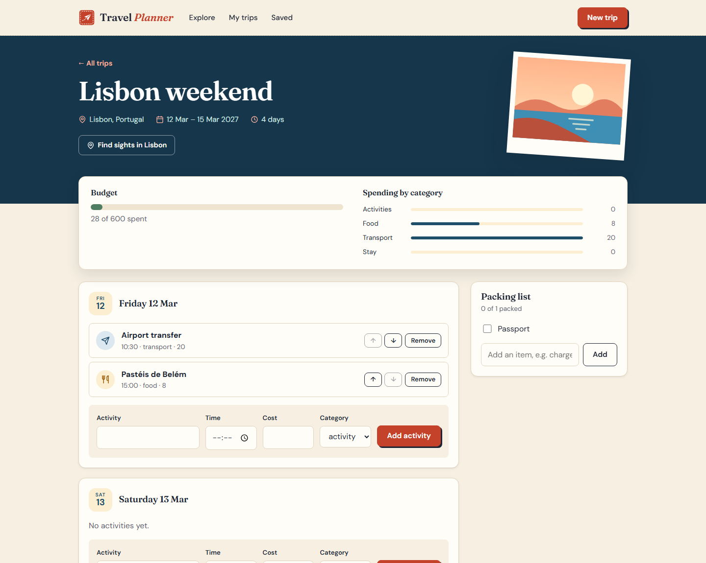
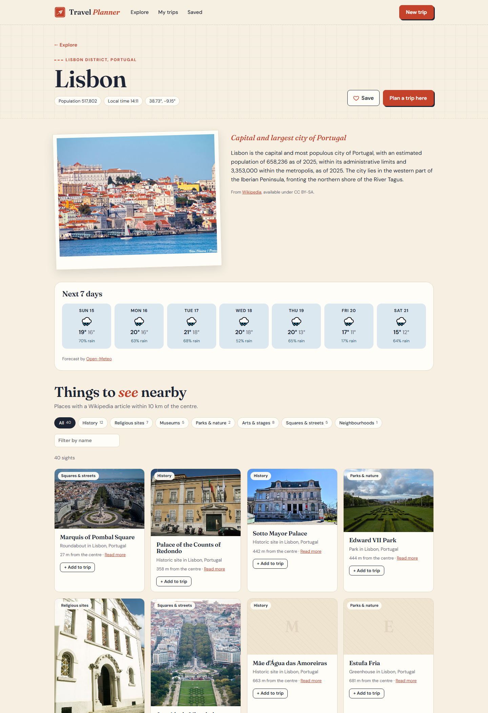

# Travel Planner

[](https://github.com/yami-qr/travel-planner/actions/workflows/ci.yml)

A responsive travel planning web app for discovering destinations and building personalised, multi-day itineraries. Built with React and TypeScript.

**Live demo:** https://itinera-olive.vercel.app

## Screenshots



| Explore | Trip |
| --- | --- |
|  |  |

<details>
<summary>Destination page: description, 7-day weather and nearby sights</summary>



</details>

## Features

- **Discover destinations:** search any city or town. Each destination page brings together a description and photo, a 7-day forecast, and the sights nearby, all from live APIs.
- **Search and filtering:** filter search results by type (cities, capitals) and country, and sort them by relevance, population or name. Filter sights by category or by name.
- **Favourites:** save destinations with the heart button. Saved places appear in your wish list and are kept between visits.
- **Multi-day itineraries:** create a trip and get one day per date. Add sights straight from a destination page to any day, or add your own activities with a time, cost and category. Reorder or remove them.
- **Budget and packing:** track spending against a budget, broken down by category, and tick off a packing list.

## Data sources

All three APIs are free and need no key, so the app runs entirely in the browser.

| Data | API |
| --- | --- |
| Place search and lookup | [Open-Meteo Geocoding](https://open-meteo.com/en/docs/geocoding-api) |
| 7-day weather forecast | [Open-Meteo Forecast](https://open-meteo.com/en/docs) |
| Description and photo | [Wikipedia REST page summary](https://en.wikipedia.org/api/rest_v1/) |
| Nearby sights | [Wikipedia geosearch](https://www.mediawiki.org/wiki/API:Geosearch) |

## How the API layer works

- **One client for every request** (`src/services/api/http.ts`). It caches successful responses in memory with a time limit per endpoint, shares one request between components that ask for the same URL at the same time, times out slow requests, and turns network failures and HTTP errors into messages that are safe to show.
- **Loading, error and retry states** come from a small `useApi` hook. When the input changes, it cancels the old request and ignores any late answer, so results never arrive out of order.
- **Search waits for typing to pause** (debounced), so there is no request per keystroke. The query is kept in the URL, so results can be shared and survive a refresh.
- **Sections fail independently.** If the weather service is down, the description and sights still load, and only the weather shows a "Try again" button.
- **Wikipedia results are cleaned up.** Nearby pages include stations, courts, schools and historical events, so each one is put into a sight category from its description, and anything that is not a sight is dropped.

## Design

The look is a travel journal: warm paper, postcards with postmarks, destinations as perforated postage stamps, and trips as boarding passes. All illustrations are drawn in SVG by the `Scenery` component, so the app ships no image files of its own. The layout adapts from phone to desktop, forms and dialogs work with a keyboard, and animations turn off for people who prefer reduced motion.

## Tech stack

- React 18 and TypeScript, built with Vite
- React Router for client-side routing
- Vitest and React Testing Library, with API calls mocked in tests
- `localStorage` for trips and favourites, through services that cope with blocked or corrupt storage
- Plain CSS with custom properties for colour and spacing

## Getting started

Requires Node.js 18 or newer.

```bash
npm install
npm run dev
```

Then open the address shown in the terminal, usually http://localhost:5173.

## Scripts

| Command | What it does |
| --- | --- |
| `npm run dev` | Start the dev server |
| `npm test` | Run the test suite once |
| `npm run build` | Type-check and build for production |
| `npm run preview` | Serve the production build locally |

## Project structure

```
src/
  components/   Reusable UI: cards, forms, modal, weather strip, sights, scenery artwork
  context/      Favourites shared across pages
  data/         Curated destinations and sample trips
  hooks/        useApi (loading, error, retry) and useDebouncedValue
  pages/        Home, Explore, destination and trip pages
  services/     API clients, plus saving trips and favourites
  styles/       Design tokens and stylesheets per area
  types/        Trip, Day, Activity and PackingItem types
  utils/        Budget, itinerary, dates, filtering and statistics (pure, unit-tested)
```

## Continuous integration

Every push and pull request to `main` runs the test suite and a type-checked production build on GitHub Actions (`.github/workflows/ci.yml`).

## Deployment

The app is deployed on Vercel. `vercel.json` sends every path to `index.html`, so links to a destination or trip page work when opened directly.
